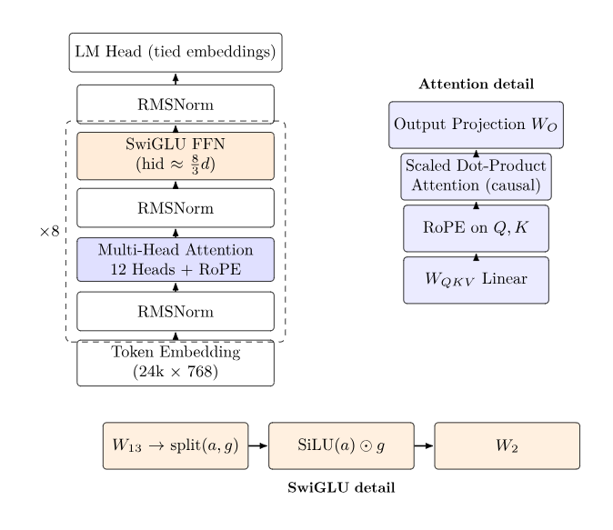
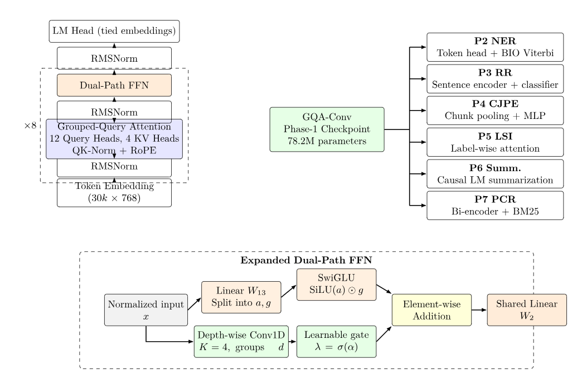
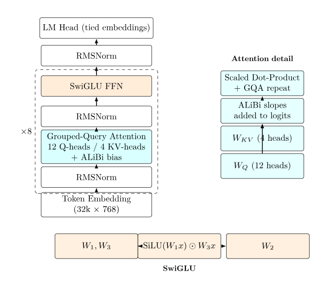
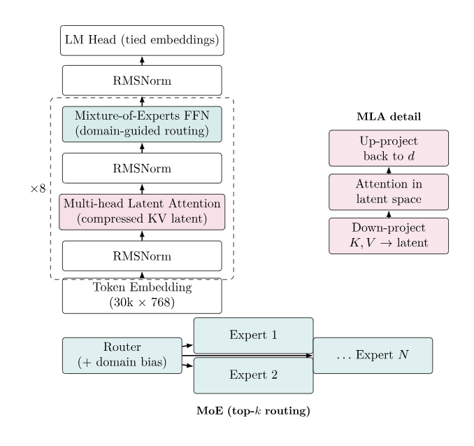

# CS781 Phase-1: Legal Language Model Foundation Models

**Course:** CS781 Capstone  
**Phase:** Phase-1 (Pre-training Foundation Models)  
**Domain:** Indian Legal Text (Acts, Supreme Court, High Courts, Tribunals)  
**Primary Goal:** Train four distinct decoder-only transformer backbones from scratch on large-scale Indian legal corpora and produce high-quality 128-word continuations for the official test set.

This repository consolidates the complete end-to-end pipelines for all four Phase-1 architectures into a single, well-documented notebook (`phase1.ipynb`). Each backbone is fully independent (own tokenizer, own checkpoint, own generation path) while sharing common data-cleaning, sharding, and evaluation utilities.

---

## Table of Contents
1. [Overview of the Four Backbones](#1-overview-of-the-four-backbones)
2. [Shared Methodology & Data Pipeline](#2-shared-methodology--data-pipeline)
3. [Architecture Details](#3-architecture-details)
   - 3.1 `custom_mha` – RoPE + Full Multi-Head Attention + SwiGLU
   - 3.2 `mla_moe` – Multi-head Latent Attention + Mixture-of-Experts
   - 3.3 `gqa_alibi` – ALiBi + Grouped-Query Attention + SwiGLU
   - 3.4 `gqa_conv` – GQA + Dual-Path FFN (SwiGLU + Depth-wise Causal Conv)
4. [Implementation Details](#4-implementation-details)
5. [Experimental Setup](#5-experimental-setup)
6. [How to Run](#6-how-to-run)
7. [Generation, Decoding Strategies & Submission](#7-generation-decoding-strategies--submission)
8. [File Layout & Checkpoints](#8-file-layout--checkpoints)
9. [Reproducibility Notes](#9-reproducibility-notes)

---

## 1. Overview of the Four Backbones

| Backbone     | Architecture Summary                                      | Vocab | Approx. Params | Context | Distinctive Features |
|--------------|-----------------------------------------------------------|-------|----------------|---------|----------------------|
| `custom_mha` | RoPE + full MHA + SwiGLU                                  | 24k   | ~66 M          | 1024    | Classic modern decoder (LLaMA-style) |
| `mla_moe`    | Multi-head Latent Attention + domain-guided MoE           | 30k   | ~80–90 M       | 1024    | Compressed KV latent + sparse experts |
| `gqa_alibi`  | ALiBi bias + GQA + SwiGLU                                 | 32k   | ~70 M          | 1024    | Position bias instead of RoPE |
| `gqa_conv`   | GQA + Dual-Path FFN (SwiGLU ∥ Depth-wise Conv1d)          | 30k   | **78.2 M**     | 1024    | Local convolutional path + learnable gate |

All models are trained with the same data mixture, the same total token budget (~150 M tokens), and the same generation target (exactly 128 words).

---

## 2. Shared Methodology & Data Pipeline

### 2.1 Data Sources
Hugging Face dataset `Exploration-Lab/CS-781-Capstone`:

- `Phase_1_Pretraining/Train/train_acts.json`
- `Phase_1_Pretraining/Train/train_supreme_court.json`
- `Phase_1_Pretraining/Train/train_high_courts.json`
- `Phase_1_Pretraining/Train/train_tribunals.json`
- `Phase_1_Pretraining/Test/test.json` (1000 prompts for submission)

### 2.2 Cleaning (`clean_text`)
Conservative, legal-domain-aware normalisation performed on **every** document and every test prompt:

- NFKC Unicode normalisation
- Quote / dash standardisation
- Control-character removal
- De-hyphenation of line-wrapped words (`word-\nword` → `wordword`)
- Removal of table-of-contents leaders (`..........`)
- Removal of pure page-number lines
- Collapsing of hard-wrapped sentences
- Aggressive whitespace normalisation while preserving paragraph breaks

### 2.3 Quality Filter (`keep_doc`)
A document is retained only if:
- length ≥ 600 characters
- ≥ 60 % alphabetic characters in the first 5 k characters
- ≤ 20 % non-ASCII (filters heavy OCR / Indic noise)
- ≥ 100 words
- type-token ratio ≥ 0.15 on the first 3 000 words (removes highly repetitive boilerplate)

### 2.4 Streaming Tokenisation & Sharding
- Constant-memory streaming with `ijson` (never loads a full JSON into RAM).
- Documents are sampled uniformly across the entire file (not just the head).
- Byte-level BPE trained independently per backbone to the target vocabulary size.
- Token sequences written as raw `uint16` binary shards (`data/<source>_train.bin`, `data/<source>_val.bin`).
- Memory-mapped reading during training → zero host-memory overhead for data loading.
- Held-out validation set created by hashing the first 400 characters of each document (`hash % 50 == 0`).

### 2.5 Training Sampler
Equal-mix (or near-equal-mix) sampler over the four legal domains.  
Typical mix used: `acts : supreme_court : high_courts : tribunals ≈ 1.0 : 1.0 : 0.15–0.30 : 0.20–0.40`.

---

## 3. Architecture Details

### 3.1 `custom_mha` – RoPE + Full Multi-Head Attention + SwiGLU

**Hyper-parameters**
```text
vocab_size = 24 000
dim        = 768
n_layers   = 8
n_heads    = 12
block_size = 1024
≈ 66 M parameters
```

**Components**
- Token embedding + weight-tied LM head
- Pre-norm RMSNorm
- Full Multi-Head Attention with Rotary Position Embeddings (RoPE, base = 10 000)
- SwiGLU feed-forward (`hid = ⌊8/3 · dim⌋` rounded to multiple of 64)
- Residual connections around both attention and FFN
- Optional gradient checkpointing

**Generation** uses a pure KV-cache decoder step with left-padding and causal masking that correctly handles pad tokens.

---

### 3.2 `mla_moe` – Multi-head Latent Attention + Mixture-of-Experts

- Multi-head Latent Attention (MLA) compresses the key/value cache into a low-rank latent representation, dramatically reducing memory bandwidth during long generation.
- Domain-guided Mixture-of-Experts (MoE) layers replace the standard FFN. Routing is lightly biased by the source domain (Acts / Supreme Court / High Courts / Tribunals) observed during training.
- Vocabulary 30 k, similar width/depth as the other models.

---

### 3.3 `gqa_alibi` – ALiBi + Grouped-Query Attention

- Attention bias is computed with the classic ALiBi slope schedule instead of RoPE.
- Grouped-Query Attention (12 query heads, 4 KV heads) for a 3× reduction in KV cache size.
- SwiGLU FFN.
- Vocabulary 32 k (largest among the four).

---

### 3.4 `gqa_conv` – Grouped-Query Attention + Dual-Path FFN  
**(Primary architecture highlighted in the report)**

**Hyper-parameters**
```text
vocab_size   = 30 000
dim          = 768
n_layers     = 8
n_heads      = 12
kv_heads     = 4                # GQA
block_size   = 1024
ffn_mult     = 3
conv_kernel  = 4
qk_norm      = True
≈ 78.2 M parameters
```

**Layer structure (×8)**
```
x → RMSNorm → GQA-Attention (RoPE + QK-Norm) → + residual
  → RMSNorm → Dual-Path FFN                 → + residual
```

**Grouped-Query Attention**
- 12 query heads, 4 key/value heads (each KV head is shared by 3 query heads).
- QK-Normalisation (RMSNorm applied to each head dimension before RoPE).
- RoPE applied after QK-Norm.
- Efficient decode path that folds the query-group dimension into the sequence length for Flash-Attention compatibility.

**Dual-Path Feed-Forward Network** (the key novelty)
```
                ┌─────────────────── SwiGLU path ───────────────────┐
x_norm ─────────┤  Linear W₁₃ → split(a,g) → SiLU(a) ⊙ g            │
                │                                                   ├─→ + → Linear W₂ → output
                └─ Depth-wise Conv1d (K=4, groups=dim) → λ = σ(α) ──┘
                   (causal, same padding, learnable scalar gate λ)
```

- The convolutional path injects a strong local inductive bias that is especially useful for legal phraseology and formulaic language.
- A single learnable scalar `α` (passed through a sigmoid) controls the contribution of the convolutional residual.
- Both paths share the final output projection `W₂`.

**Architecture Diagrams**
## Model Architectures









---

## 4. Implementation Details

### 4.1 Common Building Blocks
- **RMSNorm** – `x * rsqrt(mean(x²) + ε) * γ` (no bias).
- **RoPE** – standard complex rotation of query/key pairs; cached cos/sin tables.
- **SwiGLU** – `W₂(SiLU(W₁x) ⊙ W₃x)` (or fused `W₁₃` version).
- **Weight tying** – embedding matrix is shared with the final LM head.
- **Gradient checkpointing** – optional, activated when VRAM is tight.
- **Mixed precision** – `bfloat16` preferred on Ampere+ GPUs, falls back to `float16`.

### 4.2 Training Loop Features
- AdamW with decoupled weight decay (only on matrices of rank ≥ 2).
- Linear warm-up (100 steps) → cosine decay to `min_lr = 0.1 × lr`.
- Gradient accumulation to reach an effective batch of ~65 k tokens.
- Periodic evaluation on held-out windows and automatic checkpointing every 250 optimiser steps.
- Full resumption: optimiser state, step counter, and RNG state are saved.

### 4.3 Generation Engine
- Left-padded batching for variable-length prompts.
- True KV-cache (or latent cache for MLA) that grows only by one token per step.
- Support for four decoding strategies:
  - Greedy
  - Top-k
  - Nucleus (Top-p)
  - Beam search (with length penalty and no-repeat-n-gram)
- Automatic fallback: if a generation is shorter than the target word count, it is re-sampled with nucleus sampling and the longer candidate is kept.
- Exact 128-word truncation after decoding.

---

## 5. Experimental Setup

| Item                    | Value                                      |
|-------------------------|--------------------------------------------|
| Hardware                | Single NVIDIA A100 / H100 (or equivalent)  |
| Precision               | bfloat16 (preferred) / float16             |
| Effective batch size    | 65 536 tokens                              |
| Total tokens seen       | ~150 M                                     |
| Peak learning rate      | 6 × 10⁻⁴                                   |
| Warm-up steps           | 100                                        |
| Weight decay            | 0.1                                        |
| Gradient clipping       | 1.0                                        |
| Evaluation frequency    | every 250 steps                            |
| Checkpoint frequency    | every 250 steps                            |
| Max wall-clock          | 8 hours (auto-adjusts schedule)            |

---

## 6. How to Run

### 6.1 Prerequisites
```bash
pip install torch tqdm ijson huggingface_hub numpy
# Optional evaluation extras
pip install transformers bert-score sacrebleu evaluate datasets
```

### 6.2 Scenario A – Using Pre-trained Checkpoints (Recommended)
1. Place the four tokenizer files and four `.pt` checkpoints under `/kaggle/working/phase1-models/` (or set `DATASET_DIR`).
2. Open `phase1.ipynb`.
3. Run the **Shared path resolution** cell. It must print `exists=True` for every tokenizer and checkpoint.
4. Scroll to the desired backbone and run its **Activate backbone** cell.
5. Skip all training cells (they are already commented out).
6. Run the Generation / Prediction / Decoding-comparison cells.

### 6.3 Scenario B – Training from Scratch
1. Run the shared path cell.
2. Activate the target backbone.
3. Run the data-download + cleaning + BPE training + sharding cells.
4. Uncomment the line `model = train()` and execute it.
5. Training automatically resumes from the latest checkpoint if one exists.
6. After training finishes, proceed to the generation cells exactly as in Scenario A.

### 6.4 Producing the Official Submission
```python
# Inside the activated backbone section
predictions = predict_all(model, ids, prompts, PARTIAL_PATH, group=100)
# writes prediction.json and submission.zip
```

The final `prediction.json` maps every test ID to a dictionary `{"text": "<exactly 128 words>"}`.

---

## 7. Generation, Decoding Strategies & Submission

A comprehensive comparison utility `compare_decoding(...)` evaluates Greedy, Top-k, Nucleus and Beam Search on held-out validation prompts using ROUGE-1/2/L and Distinct-3.  

Default generation hyper-parameters used for the final submission:

```python
TARGET_WORDS   = 128
TEMPERATURE    = 0.7–0.8
TOP_P          = 0.9–0.95
TOP_K          = 40–50
REP_PENALTY    = 1.05–1.15
no_repeat_ngram = 4–6
```

---

## 8. File Layout & Checkpoints

```
phase1-models/
├── legal_bpe_custom_mha.json
├── legal_bpe_mla_moe.json
├── legal_bpe_gqa_conv.json
├── legal_bpe_tokenizer_gqa_alibi.pkl
├── legal_lm_custom_mha.pt
├── latest_checkpoint_mla_moe_1k.pt
├── latest_checkpoint_gqa_conv.pt
└── latest_checkpoint_alibi_gqa.pt

cs781_phase1/
├── data/                  # uint16 token shards
│   ├── acts_train.bin
│   ├── acts_val.bin
│   └── …
├── prediction.json
└── submission.zip
```

---

## 9. Reproducibility Notes

- All random seeds are fixed (`SEED = 42`).
- Document sampling uses a deterministic hash for the train/val split.
- Tokenizers and binary shards are cached; re-running the notebook never re-tokenises if the files already exist.
- Checkpoints contain the full model state, optimiser state, step counter and configuration dictionary, enabling exact resumption.
- The generation engine is deterministic given the same decoding hyper-parameters and the same RNG state.

---